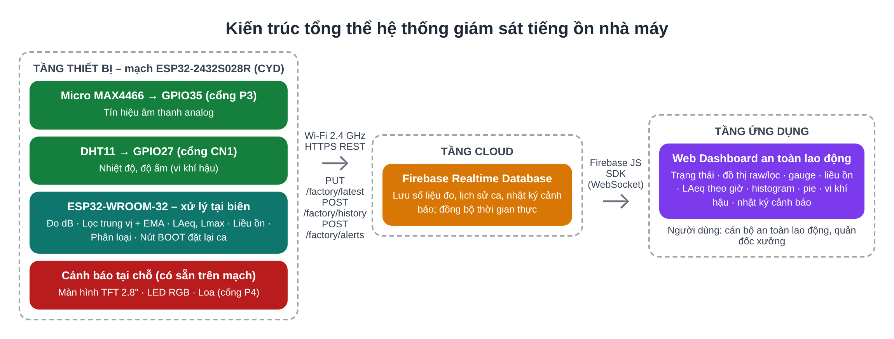
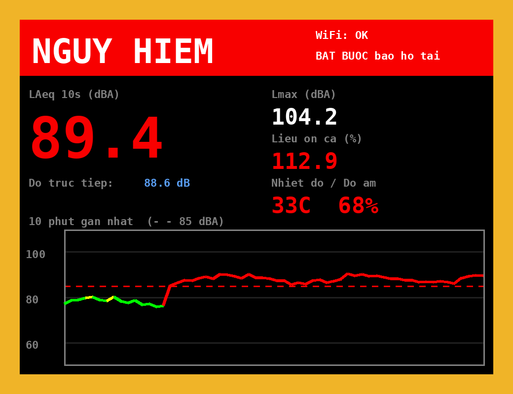
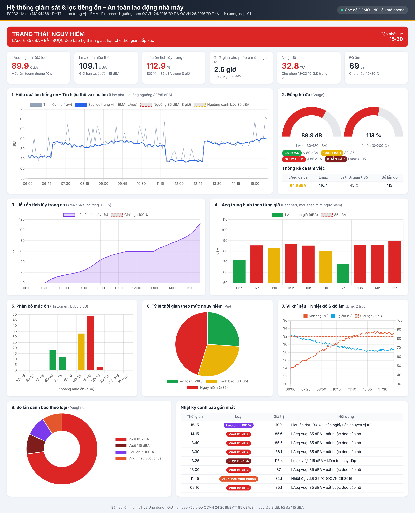
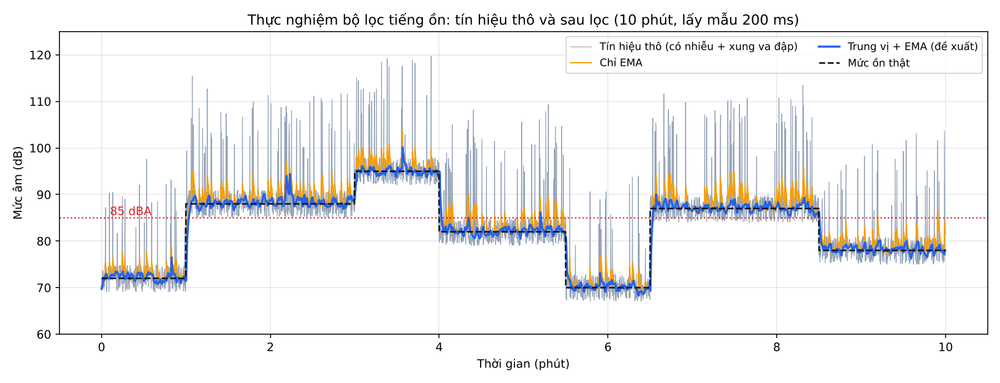

# Hệ thống IoT giám sát và lọc tiếng ồn trong nhà máy (An toàn lao động)

Bài tập lớn môn **IoT và Ứng dụng**. Thiết bị đo tiếng ồn và vi khí hậu tại xưởng sản xuất, lọc nhiễu tín hiệu ngay trên vi điều khiển, tính các chỉ số an toàn theo **QCVN 24:2016/BYT** (tiếng ồn) và **QCVN 26:2016/BYT** (vi khí hậu), cảnh báo tại chỗ và hiển thị trực quan trên web qua **Firebase Realtime Database**.

## Tính năng

- **2 cảm biến:** micro MAX4466 (mức ồn) + DHT11 (nhiệt độ, độ ẩm)
- **Lọc tiếng ồn trên ESP32:** lọc trung vị 5 mẫu (loại xung va đập) + lọc EMA α = 0,2 (làm mượt)
- **Chỉ số an toàn lao động:** LAeq 10 s, Lmax, liều ồn tích lũy trong ca (85 dBA/8 giờ, quy tắc 3 dB, tối đa 115 dBA), thời gian tiếp xúc cho phép
- **Cảnh báo 4 mức:** An toàn / Cảnh báo / Nguy hiểm / Khẩn cấp trên màn hình TFT, LED RGB và loa
- **Vẫn hoạt động khi mất Wi-Fi**, tự kết nối lại; giữ nút BOOT 2 giây để đặt lại liều ồn khi bắt đầu ca mới
- **Web dashboard** 8 dạng đồ thị: tín hiệu thô và sau lọc, gauge, liều ồn, LAeq theo giờ, histogram, pie, vi khí hậu, nhật ký cảnh báo

| Màn hình TFT tại xưởng | Web dashboard |
|---|---|
|  |  |

## Phần cứng

Mạch **ESP32-2432S028R** ("Cheap Yellow Display", màn hình 2.8" 320×240).

| Linh kiện | Nối vào CYD |
|---|---|
| Micro MAX4466 | OUT → IO35 (cổng P3), GND → P3, VCC → 3V3 (cổng CN1) |
| DHT11 | DATA → IO27 (cổng CN1), VCC → 3V3, GND → GND |
| Loa 8 Ω (tùy chọn) | Cổng SPEAK/P4 (IO26) |

Có sẵn trên mạch: màn hình TFT (SCK 14, MOSI 13, MISO 12, CS 15, DC 2, BL 21), LED RGB (4/16/17, tích cực mức thấp), nút BOOT (IO0). Chi tiết: [docs/wiring.png](docs/wiring.png), [docs/DANH_SACH_THIET_BI.txt](docs/DANH_SACH_THIET_BI.txt).

## Cấu trúc thư mục

| Thư mục | Nội dung |
|---|---|
| `cyd_noise_monitor/` | **Chương trình chính** cho mạch CYD (Arduino) |
| `test_cyd_phan_cung/` | Chương trình test màn hình (xác định ILI9341/ST7789), LED RGB, loa, DHT11, micro |
| `cyd_wokwi/` | Mô phỏng [Wokwi](https://wokwi.com): ESP32 + ILI9341 + LED RGB nối đúng chân CYD |
| `web_dashboard/` | Trang web dashboard (HTML + Chart.js + Firebase) và Security Rules |
| `filter_experiment/` | Thực nghiệm đánh giá bộ lọc bằng Python (kết quả CSV, đồ thị) |
| `ban_cu_ESP32_DevKit/` | Phiên bản cho ESP32 DevKit thường (LED rời, còi) |
| `docs/` | Hướng dẫn chạy, danh sách thiết bị, sơ đồ |

## Cách chạy nhanh

1. Arduino IDE 2 + board **esp32 by Espressif Systems**, chọn **ESP32 Dev Module**.
2. Cài thư viện: Adafruit GFX, Adafruit ILI9341, Adafruit ST7735 and ST7789, DHT sensor library.
3. Nạp `test_cyd_phan_cung` để xác định `DISPLAY_DRIVER`, `INVERT_COLORS`, `ROTATION`.
4. Tạo Firebase Realtime Database, dán `web_dashboard/database.rules.json` vào Rules.
5. Trong `cyd_noise_monitor.ino`, điền Wi-Fi, `FIREBASE_URL` và 3 thông số màn hình; hiệu chuẩn micro với `CAL_MODE 1`, rồi chạy với `CAL_MODE 0`.
6. Điền `firebaseConfig` vào `web_dashboard/index.html` và mở bằng Chrome (chưa điền thì trang chạy chế độ DEMO).

Hướng dẫn đầy đủ: [docs/HUONG_DAN_CHAY_MACH_CYD.txt](docs/HUONG_DAN_CHAY_MACH_CYD.txt).

## Kết quả thực nghiệm bộ lọc

Trung bình 20 lần chạy, tín hiệu mô phỏng 10 phút có xung va đập:

| Phương án | Sai số LAeq | Cửa sổ 10 s phân loại sai |
|---|---|---|
| Không lọc | 8,26 dB | 22,9 / 60 |
| Chỉ EMA | 1,73 dB | 4,9 / 60 |
| Chỉ trung vị | 0,79 dB | 1,6 / 60 |
| **Trung vị + EMA** | **0,60 dB** | 1,9 / 60 |

## Lưu ý

- Micro giá rẻ không có bộ lọc trọng số A chuẩn, nên giá trị dBA chỉ là ước lượng phục vụ học tập, không thay thế máy đo âm chuẩn trong quan trắc chính thức.
- Không commit mật khẩu Wi-Fi, Database secret hay `firebaseConfig` thật lên repo công khai.
